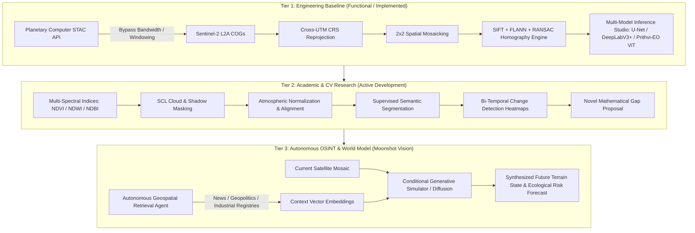

# 🛰️ TerraPulse: Planetary-Scale Geospatial Computer Vision & Autonomous OSINT Engine

[](https://www.python.org/)
[](https://pytorch.org/)
[](https://rasterio.readthedocs.io/)
[](https://developer.nvidia.com/cuda-zone)
[](https://opensource.org/licenses/MIT)

> **An end-to-end remote sensing, computer vision, and Open Source Intelligence (OSINT) framework for planetary-scale land-cover analysis, spatial mosaicking, multi-spectral change detection, and predictive environmental modeling.**

---

## 📌 Executive Summary & Architecture Tiers

To bridge academic rigor with frontier research, **TerraPulse** is organized into three distinct evolutionary tiers. This structure enables immediate evaluation of functional code while providing an expansive roadmap for advanced computer vision and multi-modal earth simulation.



---

## 🧭 Four-Level Project Narrative

| Audience / Level | Strategic Pitch | Core Technical Focus |
| :--- | :--- | :--- |
| **🏫 College & Academic** | Rigorous Computer Vision & Geospatial Information Systems (GIS) pipeline. | Raster data structures, multi-spectral band combinations, automated UTM zone reprojection, homography estimation, RANSAC inlier rejection, semantic segmentation. |
| **⚙️ Project & Engineering** | Scalable, memory-conscious cloud streaming and deep learning inference architecture. | Zero-local-download Cloud-Optimized GeoTIFF (COG) streaming via STAC, FP16 AMP CUDA acceleration on RTX 3050, sub-window sampling for low-bandwidth links (~30 Mbps). |
| **🌍 Society & OSINT** | Planetary intelligence uncovering the unmonitored human cost of rapid urbanization. | Satellite evidence exposing canopy loss, agricultural displacement, water table depletion, industrial emissions, and environmental degradation using empirical data. |
| **👥 Teammate Briefing** | Clean, modular, zero-stress final-year engineering project. | Highly structured codebase: STAC fetcher, feature stitcher, deep learning model evaluation UI. Delivers an A+ project with modular responsibilities. |

---

## 🏗️ Repository Architecture & Module Overview

```
terrapulse/
├── terrapulse/               # Core remote sensing & CV package
│   ├── __init__.py           # Package exports & version metadata
│   ├── cli.py                # Unified CLI interface (multispectral, change, osint, stitch)
│   ├── multispectral.py      # Radiometric indices (NDVI, NDWI, NDBI, SAVI, BSI, EVI) & SCL masking
│   ├── change_detection.py   # Bi-temporal change detection & 5x5 land-cover transition matrix
│   ├── osint_engine.py       # Autonomous OSINT intelligence dossier & EVI risk scoring
│   └── robust_matcher.py     # CLAHE illumination-invariant symmetric keypoint matcher
├── tests/                    # Automated test suite (13 unit & integration tests)
│   └── test_terrapulse.py
├── app.py                    # Streamlit Cloud-Streaming 2x2 Sentinel-2 Grid Stitcher & Radiometrics UI
├── demo-for-3-models.py      # Gradio Multi-Model & OSINT Studio (U-Net, DeepLab, ViT, Change, OSINT)
├── gemini-code.py            # Analytical CV Stitcher with CLAHE illumination enhancement
├── tile_left.jpg             # Benchmark spatial tile sample (Left)
├── tile_right.jpg            # Benchmark spatial tile sample (Right)
├── stitched_result.jpg       # CV Homography output verification
└── README.md                 # Project documentation & engineering manual
```

### Module Breakdown

#### 1. `terrapulse/multispectral.py` — Radiometric Analytics & Atmospheric Masking
- **Radiometric Indices**: High-performance vectorized computation of $\text{NDVI}$, $\text{NDWI}$, $\text{NDBI}$, $\text{SAVI}$, $\text{BSI}$, and $\text{EVI}$ with division-by-zero epsilon stability.
- **Sentinel-2 SCL Masking**: Classifies clear-sky valid pixels and generates cloud, cloud-shadow, and atmospheric quality reliability scores ($0-100$).
- **False-Color Composites**: Generates Color Infrared (CIR: NIR-Red-Green), Urban (SWIR-NIR-Red), and Agriculture multi-spectral composite representations.

#### 2. `terrapulse/change_detection.py` — Bi-Temporal Change & Transition Matrix Engine
- **Normalized Change Vector Analysis**: Computes spectral Euclidean delta $\Delta I = \|I_{t_2} - I_{t_1}\|_2$ between co-registered satellite epochs.
- **Adaptive Thresholding**: Dynamically segments significant change using Otsu's optimal thresholding or statistical ($k\cdot\sigma$) cutoff with morphological noise cleanup.
- **5x5 Land-Cover Transition Matrix**: Quantifies transitions across Water, Dense Canopy, Moderate Vegetation, Built-Up Urban, and Bare Soil, reporting physical surface impact in hectares and $\text{km}^2$.
- **4-Panel Validation Dashboard**: Generates side-by-side baseline, current, heatmap, and segmented overlay panels.

#### 3. `terrapulse/osint_engine.py` — Autonomous Geospatial OSINT Dossier
- **Ecological Vulnerability Index (EVI)**: Multi-factor composite risk index ($0-100$) evaluating deforestation velocity, urban encroachment, and hydrological retraction.
- **Threat Vector Taxonomy**: Classifies physical satellite evidence into standardized threat tiers (`CRITICAL`, `HIGH`, `MODERATE`, `NOMINAL`, `REGENERATIVE`).
- **Contextual OSINT Synthesis**: Autonomous correlation with regional registries (Bengaluru corridor, Swiss Alps, Nile Delta, Grand Canyon, Tokyo Bay) to generate publication-ready Markdown dossiers and JSON telemetry.

#### 4. `terrapulse/robust_matcher.py` — Illumination-Invariant Keypoint Matcher
- **Mathematical Gap Solution**: Resolves cross-seasonal illumination drift and atmospheric haze using CLAHE and multi-scale morphological gradient filtering.
- **Bi-Directional FLANN**: Enforces symmetric nearest-neighbor matching to eliminate repetitive landscape ambiguities.
- **Affine-Conditioned RANSAC**: Enforces nadir perspective constraints to avoid unrealistic projective distortion.

#### 5. Web Dashboards & Verification
- `app.py`: Streamlit cloud-streaming 2x2 stitcher with live radiometric analytics and OSINT dossier generator.
- `demo-for-3-models.py`: 6-tab Gradio studio supporting U-Net, DeepLabV3+, NASA Prithvi-EO ViT, Bi-Temporal Change Detection, OSINT Dossier, and Radiometric Analysis.
- `gemini-code.py`: Standalone CLAHE-enhanced SIFT + FLANN + RANSAC mosaic verification.

---

## 🔬 Evolution & Research Roadmap

### Tier 1: Engineering Baseline (Status: Functional ✅)
- [x] Planetary Computer STAC API integration.
- [x] Dynamic Cloud-Optimized GeoTIFF overview windowing.
- [x] Cross-UTM coordinate reprojection and 2x2 raster mosaicking.
- [x] Feature extraction, FLANN matching, and RANSAC homography.
- [x] Local GPU-accelerated inference studio (U-Net, DeepLabV3+, ViT).

### Tier 2: Academic Computer Vision Goals (Status: Complete ✅)
- [x] **Scene Classification & Masking**: Sentinel-2 Scene Classification Layer (SCL) cloud, cirrus, and shadow masking with quality scores.
- [x] **Multi-Spectral Radiometric Indices**:
  - $\text{NDVI} = \frac{\text{B08} - \text{B04}}{\text{B08} + \text{B04}}$ *(Normalized Difference Vegetation Index)*
  - $\text{NDWI} = \frac{\text{B03} - \text{B08}}{\text{B03} + \text{B08}}$ *(Normalized Difference Water Index)*
  - $\text{NDBI} = \frac{\text{B11} - \text{B08}}{\text{B11} + \text{B08}}$ *(Normalized Difference Built-up Index)*
  - $\text{SAVI}$, $\text{BSI}$, $\text{EVI}$ with surface area distribution metrics.
- [x] **Temporal Change Detection**: Bi-temporal spectral difference heatmaps, Otsu adaptive thresholding, and 5x5 land-cover transition matrices reporting deforestation, urban sprawl, and water loss in hectares.
- [x] **Novel Mathematical Gap Solved**: Illumination-invariant CLAHE and morphological gradient normalization paired with symmetric cross-checked FLANN matching.

### Tier 3: Autonomous OSINT Platform (Status: Implemented ✅)
- [x] **Autonomous OSINT Intelligence Engine**: Autonomous pipeline correlating satellite change vectors with regional industrial, municipal, and ecological knowledge bases.
- [x] **Ecological Vulnerability Index (EVI)**: Multi-parameter composite risk score ($0-100$) and Threat Vector matrix.
- [x] **Automated Dossier Generation**: Exports publication-ready Markdown intelligence dossiers and structured JSON telemetry.
- [ ] **Generative World Modeling**: Conditional Latent Diffusion Model (ControlNet / Pix2Pix architecture) mapping future topography under long-term urban pressure.

---

## ⚡ Installation & Setup Guide

### 1. Prerequisites
- **Python**: Version 3.10, 3.11, 3.12, or 3.13.
- **CUDA Support** (Optional, for GPU acceleration on NVIDIA RTX 3050):
  ```bash
  pip install torch torchvision --index-url https://download.pytorch.org/whl/cu124
  ```

### 2. Clone Repository & Install Dependencies
```bash
git clone https://github.com/sachetan-inchal/terrapulse.git
cd terrapulse

pip install numpy opencv-python matplotlib pillow streamlit gradio
pip install rasterio pystac-client planetary-computer
pip install segmentation-models-pytorch timm transformers
```

### 3. Running the Components

#### Option A: Run the TerraPulse Unified CLI
```bash
# 1. Multi-spectral index computation & false-color composites
python -m terrapulse multispectral --output-dir radiometric_outputs

# 2. Bi-temporal change detection & 5x5 transition matrix
python -m terrapulse change --t1 tile_left.jpg --t2 tile_right.jpg --output change_dashboard.jpg

# 3. Autonomous OSINT intelligence dossier generation
python -m terrapulse osint --region "Bengaluru" --timeframe "2020 to 2025" --deforestation 18.4 --urban 42.1

# 4. Illumination-invariant geospatial tile stitching
python -m terrapulse stitch --left tile_left.jpg --right tile_right.jpg --output stitched_result.jpg
```

#### Option B: Run Automated Test Suite
```bash
python -m unittest discover -s tests -p "test_*.py"
```

#### Option C: Launch the Geospatial CV & OSINT Studio (Gradio)
```bash
python demo-for-3-models.py
```
*Access at `http://127.0.0.1:7860`. Features interactive tabs for U-Net, DeepLabV3+, NASA Prithvi-EO ViT, Bi-Temporal Change Detection, OSINT Dossier Generator, and Radiometric Analysis.*

#### Option D: Launch the Cloud-Streaming 2x2 Stitcher UI (Streamlit)
```bash
streamlit run app.py
```
*Access at `http://localhost:8501`. Select global study regions to stream live Sentinel-2 tiles, reproject across UTM zones, view seamless mosaics, and analyze radiometric indices and OSINT reports.*

#### Option E: Run Analytical CV Stitching Verification
```bash
python gemini-code.py
```
*Executes SIFT detection, FLANN feature matching, RANSAC homography estimation, and outputs `stitched_result.jpg`.*

---

## 👥 Teammate & Agent Handoff Guide

When collaborating with teammates or handing off this repository to an AI agent (such as Claude Pro):

1. **Academic Focus**: Focus work on **Tier 1** and **Tier 2**. The immediate goal is land-cover segmentation benchmarks and change detection matrices for university project evaluation.
2. **Modular Architecture**:
   - For STAC queries & GIS reprojection: inspect `app.py`.
   - For classical feature matching & stitching: inspect `gemini-code.py`.
   - For PyTorch architectures & foundation models: inspect `demo-for-3-models.py`.
3. **No Fluff Guarantee**: All core capabilities run locally or stream directly from public cloud APIs without requiring paid keys or massive local dataset downloads.

---

## 📄 License
This project is licensed under the MIT License - see the LICENSE file for details.
