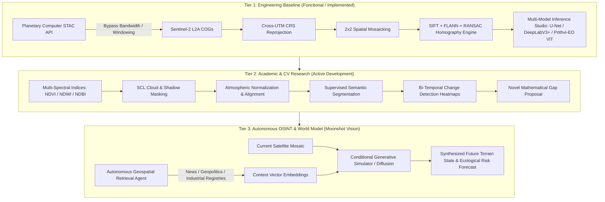

# 🛰️ TerraPulse: Planetary-Scale Geospatial Computer Vision & Autonomous OSINT Engine

[](https://www.python.org/)
[](https://pytorch.org/)
[](https://rasterio.readthedocs.io/)
[](https://developer.nvidia.com/cuda-zone)
[](https://opensource.org/licenses/MIT)

> **An end-to-end remote sensing, computer vision, and Open Source Intelligence (OSINT) framework for planetary-scale land-cover analysis, spatial mosaicking, multi-spectral change detection, and predictive environmental modeling.**

---

## 📌 Executive Summary & Architecture Tiers

To bridge academic rigor with frontier research, **TerraPulse** is organized into three distinct evolutionary tiers. This structure enables immediate evaluation of functional code while providing an expansive roadmap for advanced computer vision and multi-modal earth simulation.



---

## 🧭 Four-Level Project Narrative

| Audience / Level | Strategic Pitch | Core Technical Focus |
| :--- | :--- | :--- |
| **🏫 College & Academic** | Rigorous Computer Vision & Geospatial Information Systems (GIS) pipeline. | Raster data structures, multi-spectral band combinations, automated UTM zone reprojection, homography estimation, RANSAC inlier rejection, semantic segmentation. |
| **⚙️ Project & Engineering** | Scalable, memory-conscious cloud streaming and deep learning inference architecture. | Zero-local-download Cloud-Optimized GeoTIFF (COG) streaming via STAC, FP16 AMP CUDA acceleration on RTX 3050, sub-window sampling for low-bandwidth links (~30 Mbps). |
| **🌍 Society & OSINT** | Planetary intelligence uncovering the unmonitored human cost of rapid urbanization. | Satellite evidence exposing canopy loss, agricultural displacement, water table depletion, industrial emissions, and environmental degradation using empirical data. |
| **👥 Teammate Briefing** | Clean, modular, zero-stress final-year engineering project. | Highly structured codebase: STAC fetcher, feature stitcher, deep learning model evaluation UI. Delivers an A+ project with modular responsibilities. |

---

## 🏗️ Repository Architecture & Module Overview

```
CCVR/
├── app.py                   # Streamlit Cloud-Streaming 2x2 Sentinel-2 Grid Stitcher
├── demo-for-3-models.py      # Gradio Multi-Model Studio (U-Net, DeepLabV3+, NASA Prithvi ViT)
├── gemini-code.py           # Standalone CV Feature Stitcher (SIFT, FLANN, RANSAC Homography)
├── tile_left.jpg            # Benchmark spatial tile sample (Left)
├── tile_right.jpg           # Benchmark spatial tile sample (Right)
├── stitched_result.jpg      # CV Homography output verification
└── README.md                # Project documentation & engineering manual
```

### Module Breakdown

#### 1. `app.py` — Cloud-Native STAC Pipeline & Spatial Mosaicker
- **Catalog Ingestion**: Directly interfaces with Microsoft Planetary Computer STAC API (`sentinel-2-l2a` collection).
- **Dynamic Filtering**: Applies temporal querying and cloud cover filtering (`eo:cloud_cover < 5.0%`).
- **Overview Sampling**: Implements on-the-fly decimation (scale factor = 15) to stream multi-spectral data over consumer broadband (~30 Mbps) without saturating local RAM.
- **Geodetic Alignment**: Dynamically computes target UTM CRS transformations via `rasterio.warp.calculate_default_transform` and reprojects adjacent tiles across UTM boundaries using bilinear resampling.
- **Raster Merging**: Blends multi-tile arrays into a continuous coordinate-anchored mosaic.

#### 2. `gemini-code.py` — Analytical Computer Vision & Stitching Engine
- **Feature Extraction**: Extracts scale-invariant keypoints via SIFT (Scale-Invariant Feature Transform).
- **Nearest Neighbor Matching**: Uses FLANN-based KD-tree matcher with 5 parallel trees and 50 search checks.
- **Outlier Pruning**: Enforces Lowe's ratio test (`distance < 0.75 * second_distance`) to discard ambiguous matches.
- **Geometric Transformation**: Computes 3×3 perspective homography matrix $H$ using RANSAC with a 5.0-pixel reprojection error threshold.
- **Safety Gate**: Rejects alignment if inlier ratio falls below 25%, preventing artifact generation from seasonal drift or non-overlapping scenes.

#### 3. `demo-for-3-models.py` — Deep Learning & Foundation Model Studio
- **Hardware Acceleration**: Built for NVIDIA RTX 3050 (4GB/6GB VRAM) with PyTorch `torch.amp.autocast("cuda")` for low-latency FP16 inference.
- **Model 1 (U-Net)**: ResNet-18 backbone pretrained on ImageNet for high-resolution semantic segmentation.
- **Model 2 (DeepLabV3+)**: MobileNetV2 backbone leveraging Atrous Spatial Pyramid Pooling (ASPP) for multi-scale boundary extraction.
- **Model 3 (NASA Prithvi-EO / ViT)**: IBM-NASA Geospatial Foundation Model backbone / Vision Transformer (16x16 patch projection), outputting spatial token activation heatmaps (14×14 grid) and global `[CLS]` embedding statistics.

---

## 🔬 Evolution & Research Roadmap

### Tier 1: Engineering Baseline (Status: Functional)
- [x] Planetary Computer STAC API integration.
- [x] Dynamic Cloud-Optimized GeoTIFF overview windowing.
- [x] Cross-UTM coordinate reprojection and 2x2 raster mosaicking.
- [x] Feature extraction, FLANN matching, and RANSAC homography.
- [x] Local GPU-accelerated inference studio (U-Net, DeepLabV3+, ViT).

### Tier 2: Academic Computer Vision Goals (Status: In Progress)
- [ ] **Scene Classification & Masking**: Implement Sentinel-2 Scene Classification Layer (SCL) cloud and cloud-shadow masking.
- [ ] **Multi-Spectral Indices**: Automated radiometric index computation:
  - $\text{NDVI} = \frac{\text{B08} - \text{B04}}{\text{B08} + \text{B04}}$ *(Normalized Difference Vegetation Index)*
  - $\text{NDWI} = \frac{\text{B03} - \text{B08}}{\text{B03} + \text{B08}}$ *(Normalized Difference Water Index)*
  - $\text{NDBI} = \frac{\text{B11} - \text{B08}}{\text{B11} + \text{B08}}$ *(Normalized Difference Built-up Index)*
- [ ] **Temporal Change Detection**: Compute bi-temporal feature difference: $\Delta(t_1, t_2) = \|\mathbf{E}_{t_2} - \mathbf{E}_{t_1}\|_2$, where $\mathbf{E}_t$ represents the latent spatial feature tensor extracted by the foundation encoder.
- [ ] **Novel Mathematical Gap**: Formulate an illumination-invariant or cloud-tolerant keypoint descriptor tailored for multi-spectral remote-sensing imagery across cross-seasonal acquisitions.

### Tier 3: Autonomous OSINT Platform & Predictive Earth Simulator (Status: Vision)
- [ ] **OSINT Context Engine**: Autonomous agent pipeline querying news archives, municipal development permits, industrial registries, and energy footprint data for any coordinate bounding box.
- [ ] **Multi-Modal Feature Fusion**: Project unstructured text and economic time-series indicators into joint latent space with satellite terrain embeddings.
- [ ] **Generative World Modeling**: Conditional Latent Diffusion Model (ControlNet / Pix2Pix architecture) mapping:  
  $\text{Satellite Mosaic}(t_0) + \text{Agent Context}(t_0 \to t_n) \longrightarrow \widehat{\text{Satellite State}}(t_n)$  
  to synthesize a high-fidelity visual prediction of future topography, urban encroachment, and environmental depletion.

---

## ⚡ Installation & Setup Guide

### 1. Prerequisites
- **Python**: Version 3.10 or 3.11 recommended.
- **CUDA Support** (Optional, for GPU acceleration on NVIDIA RTX 3050):
  ```bash
  pip install torch torchvision --index-url https://download.pytorch.org/whl/cu124
  ```

### 2. Clone Repository & Install Dependencies
```bash
git clone https://github.com/sachetan-inchal/terrapulse.git
cd terrapulse

pip install numpy opencv-python matplotlib pillow streamlit gradio
pip install rasterio pystac-client planetary-computer
pip install segmentation-models-pytorch timm transformers
```

### 3. Running the Components

#### Option A: Launch the Cloud-Streaming 2x2 Stitcher UI
```bash
streamlit run app.py
```
*Access the interface at `http://localhost:8501`. Select global study regions (Swiss Alps, Grand Canyon, Nile Delta, Tokyo) to view on-the-fly STAC streaming, cross-UTM reprojection, and mosaicking.*

#### Option B: Launch the Deep Learning Model Studio
```bash
python demo-for-3-models.py
```
*Access the Gradio studio at `http://127.0.0.1:7860`. Test U-Net, DeepLabV3+, and ViT/Prithvi-EO foundation models on local satellite chips with real-time activation heatmaps.*

#### Option C: Run the Analytical CV Stitching Verification
```bash
python gemini-code.py
```
*Executes SIFT detection, FLANN feature matching, RANSAC homography estimation, and outputs `stitched_result.jpg`.*

---

## 👥 Teammate & Agent Handoff Guide

When collaborating with teammates or handing off this repository to an AI agent (such as Claude Pro):

1. **Academic Focus**: Focus work on **Tier 1** and **Tier 2**. The immediate goal is land-cover segmentation benchmarks and change detection matrices for university project evaluation.
2. **Modular Architecture**:
   - For STAC queries & GIS reprojection: inspect `app.py`.
   - For classical feature matching & stitching: inspect `gemini-code.py`.
   - For PyTorch architectures & foundation models: inspect `demo-for-3-models.py`.
3. **No Fluff Guarantee**: All core capabilities run locally or stream directly from public cloud APIs without requiring paid keys or massive local dataset downloads.

---

## 📄 License
This project is licensed under the MIT License - see the LICENSE file for details.
