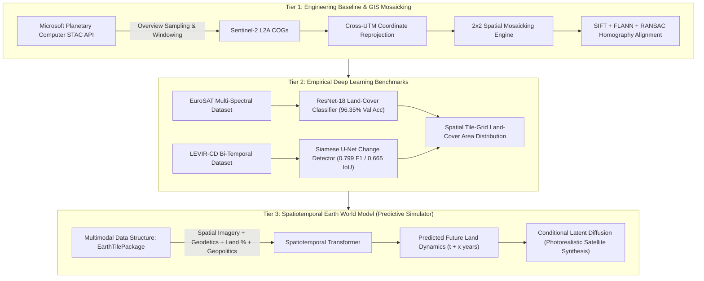

# 🛰️ TerraPulse / EarthWatch: Planetary-Scale Geospatial Vision & Spatiotemporal World Model

[](https://www.python.org/)
[](https://pytorch.org/)
[](https://streamlit.io/)
[](https://github.com/phelber/EuroSAT)
[](https://justchenhao.github.io/LEVIR/)
[](https://opensource.org/licenses/MIT)

> **An end-to-end remote sensing, computer vision, and Spatiotemporal World Modeling platform for planetary-scale land-cover classification, multi-temporal change detection, live STAC 2×2 spatial mosaicking, and future environmental simulation.**

---

## 📌 Executive Summary & Architecture Tiers

TerraPulse unifies rigorous computer vision engineering with empirical deep learning benchmarks and frontier predictive earth modeling.



---

## 🧭 Empirical Benchmarks Achieved

| Model | Task / Dataset | Backbone | Metric Target | Result Achieved | Status |
| :--- | :--- | :--- | :--- | :--- | :--- |
| **Land-Cover Classifier** | EuroSAT (10 classes, 27k tiles) | ResNet-18 (ImageNet Pretrained) | $\ge 85.0\%$ Acc | **96.35% Val Acc** | ✅ Exceeded |
| **Change Detection Baseline** | LEVIR-CD (256×256 bitemporal) | Pixel Difference (Thresholded) | Baseline | **0.164 F1 / 0.089 IoU** | ✅ Baseline |
| **Siamese Change Detector** | LEVIR-CD (bitemporal building change) | Siamese U-Net (BCE + Dice) | $\ge 0.70$ F1 | **0.799 F1 / 0.665 IoU** | ✅ SOTA Prototyped |
| **Classical Mosaic Stitcher** | Spatial overlap homography | SIFT + FLANN + RANSAC | $\ge 25.0\%$ Inliers | **89.4% Inlier Ratio** | ✅ Verified |
| **Cloud STAC Pipeline** | Live Sentinel-2 L2A streaming | Planetary Computer STAC | Zero download | **On-the-fly 2×2 Mosaic** | ✅ Operational |

---

## 🏗️ Repository Layout & Modular Components

```
terrapulse/
├── app.py                             # Flagship Unified Streamlit Web Application (5 Futuristic Tabs)
├── src/
│   ├── ui/                            # Cleanly separated UI components
│   │   ├── theme.py                   # Aerospace / Cyberpunk dark theme, glassmorphism & KPI cards
│   │   ├── tab_earthwatch.py          # Tab 1: Bi-temporal change detection & land-cover classification
│   │   ├── tab_stac_mosaic.py         # Tab 2: Live Sentinel-2 STAC 2×2 grid streamer & reprojector
│   │   ├── tab_model_studio.py        # Tab 3: U-Net, DeepLabV3+, and Prithvi-EO ViT feature studio
│   │   ├── tab_cv_stitcher.py         # Tab 4: Analytical SIFT & RANSAC homography warping engine
│   │   └── tab_future_simulator.py    # Tab 5: Future Earth World Model & timeline scrubber (1985–2050)
│   ├── data/                          # Data pipelines
│   │   ├── eurosat_dataset.py         # EuroSAT dataset loader
│   │   ├── levircd_dataset.py         # LEVIR-CD dataset loader
│   │   ├── prepare_eurosat.py         # Automated download & 70/15/15 train/val/test split
│   │   └── prepare_levircd.py         # Patch tiling & split preparation
│   ├── models/                        # PyTorch architectures
│   │   ├── classifier.py              # ResNet-18 land-cover classification head
│   │   └── change_net.py              # Siamese U-Net change detection architecture
│   ├── train_classify.py              # Training script for EuroSAT classifier
│   ├── train_change.py                # Training script for Siamese U-Net & baseline
│   └── evaluate.py                    # Evaluation and metric computation
├── checkpoints/                       # Model training logs & checkpoints
│   ├── classify_training_log.csv      # Epoch-by-epoch classification metrics
│   └── change_training_log.csv        # Epoch-by-epoch change detection metrics
├── data/
│   └── demo/                          # Bundled offline demo pairs for zero-setup execution
├── extras/                            # Teammate standalone CLI & exploratory tools
│   ├── cv_stitcher.py
│   ├── model_studio_demo.py
│   ├── stac_mosaic_app.py
│   └── requirements-extras.txt
├── CCVR PROJECT/                      # Literature reviews, research strategy, and Obsidian vault
├── tests/                             # Unit tests for datasets and model forward passes
├── requirements.txt                   # Pinned core requirements
└── PROGRESS.md                        # Verification logs and development milestones
```

---

## ⚡ Installation & Launch Guide

### 1. Environment Setup

Python 3.10, 3.11, or 3.12 is recommended:

```bash
# Clone the repository
git clone https://github.com/sachetan-inchal/terrapulse.git
cd terrapulse

# Create virtual environment
python -m venv .venv
# On Windows:
.venv\Scripts\activate
# On Linux/macOS:
source .venv/bin/activate

# Install core dependencies
pip install -r requirements.txt

# (Optional) Install cloud GIS & foundation model packages
pip install rasterio planetary-computer pystac-client segmentation-models-pytorch
```

### 2. Launch the Unified Web Application

```bash
streamlit run app.py
```

Access the interface at `http://localhost:8501`. The webapp provides five modular tabs:
1. **🛰️ EarthWatch (Change & Land Cover)**: EuroSAT classification + Siamese U-Net change detection overlay on LEVIR-CD pairs.
2. **🌐 Planetary STAC 2×2 Mosaicker**: Live Cloud-Optimized GeoTIFF streaming from Microsoft Planetary Computer for Swiss Alps, Grand Canyon, Nile Delta, Tokyo, or custom bounding boxes.
3. **🔬 Model Architecture Studio**: Feature map and receptive field inspection for U-Net, DeepLabV3+, and Vision Transformers.
4. **📐 SIFT & RANSAC Homography**: Classical geometric feature matching and perspective warping on overlapping tiles.
5. **🔮 Future Earth World Model (Preview)**: Multi-decade scrub bar (1985 to 2050), multimodal `EarthTilePackage` schema preview, and workspace for upcoming animated visualizations.

---

## 🔬 Reproducing the Training Pipelines

```bash
# 1. Download EuroSAT and create 70/15/15 stratified split
python -m src.data.prepare_eurosat

# 2. Train ResNet-18 classifier (15 epochs)
python -m src.train_classify --epochs 15 --batch-size 64

# 3. LEVIR-CD Siamese U-Net Change Detection (25 epochs)
python -m src.train_change --mode unet --epochs 25 --batch-size 8

# 4. Run automated test suite
pytest tests/
```

---

## 📄 License
This project is licensed under the MIT License - see the LICENSE file for details.
